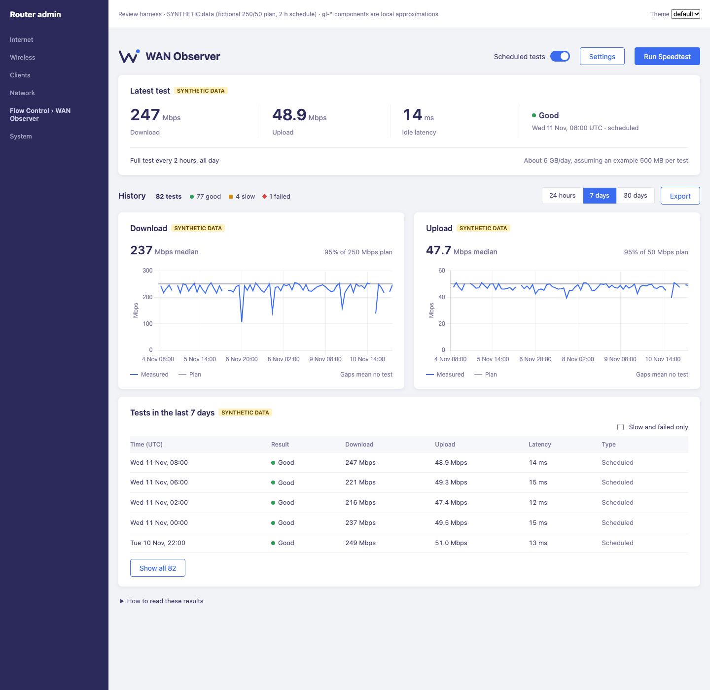
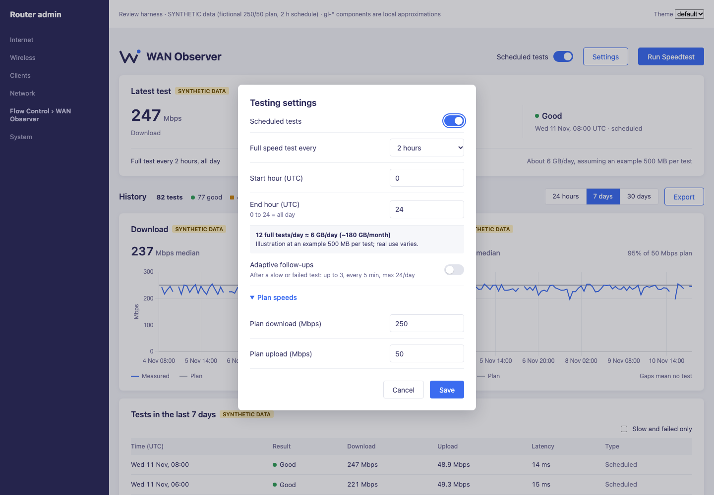
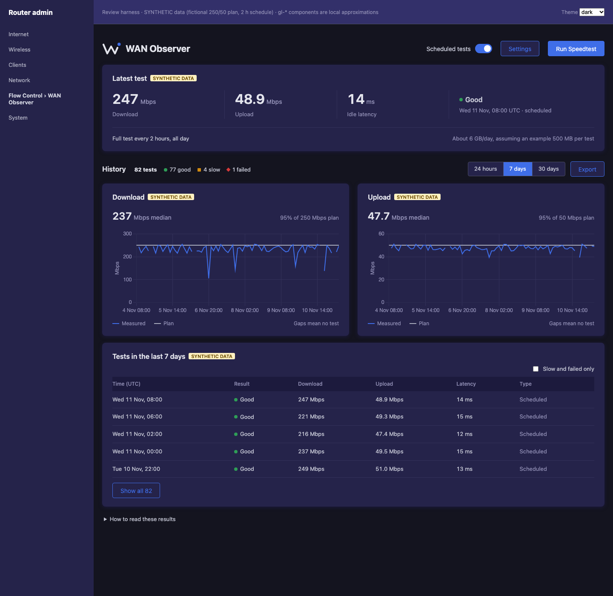

<p align="center">
  
  
</p>

<p align="center"><strong>Local speed-test history for your router — so “the internet is slow again” becomes a record you can inspect, export and share with your provider.</strong></p>

<p align="center">
  <a href="https://github.com/ddedic/openwrt-wan-observer/actions/workflows/test.yml"></a>
  <a href="LICENSE"></a>
  
  
</p>

<p align="center">
  <a href="https://github.com/ddedic/openwrt-wan-observer/releases"><strong>Download</strong></a> ·
  <a href="#install-on-a-glinet-flint-2">Install</a> ·
  <a href="docs/TECHNICAL.md">Technical guide</a> ·
  <a href="CONTRIBUTING.md">Contribute</a>
</p>

<p align="center">
  
</p>

<p align="center"><sub><b>Synthetic demo.</b> Rendered locally from the production UI bundle with invented data (fictional 250/50 Mbps plan). The router admin shell and GL.iNet components are local approximations, not an on-device screenshot.</sub></p>

## Why

Intermittent slowdowns are hard to prove from memory. WAN Observer keeps a bounded, private history of speed tests on the router itself and turns it into charts, a plain-language summary and exports you can hand to support. No cloud account, no telemetry.

## Features

- **Native router page** — GL.iNet SDK4 plugin under **Flow Control → WAN Observer**, using the admin panel's own components and theme.
- **Run Speedtest** — one immediate test on demand, also while scheduling is paused.
- **Schedules you control** — pause/resume, testing hours and frequency. An illustrative daily/monthly data estimate is shown *before* you enable unattended tests.
- **Your plan as the baseline** — editable plan download/upload speeds; charts and results compare against them.
- **Optional adaptive follow-ups** — opt in to up to 3 extra tests, 5 minutes apart, after a slow or failed test; capped at 24 extras per UTC day.
- **Exports** — direct A4 PDF report (optional detailed appendix) and CSV for the selected period.
- **Bounded history** — count-based retention (default 1,000, max 10,000 records); private files, atomic writes.
- **Small footprint** — POSIX shell + jq on the router. No Python, database or container.
- **Privacy by allowlist** — IP/MAC addresses, hostnames, ISP labels and result links are discarded on import.

<details>
<summary>More screenshots — settings and dark theme</summary>





</details>

## Install on a GL.iNet Flint 2

1. Download the matching **`wan-observer`** and **`wan-observer-glinet`** IPKs from [Releases](https://github.com/ddedic/openwrt-wan-observer/releases).
2. Copy them to the router and install both:
   ```sh
   opkg install /path/to/wan-observer_*.ipk /path/to/wan-observer-glinet_*.ipk
   ```
3. Configure a permitted speed-test binary and schedule — see [collector setup](docs/COLLECTOR.md).
4. Sign in to the admin panel and open **Flow Control → WAN Observer**.

**Installation runs no tests.** Nothing is measured until you press **Run Speedtest** or enable a schedule. WAN Observer does not bundle Ookla software or accept third-party terms for you.

## Compatibility and status

| Component | Status |
| --- | --- |
| GL.iNet SDK4 plugin (`wan-observer-glinet` 0.4.4) | Installed and checked on a GL-MT6000 (Flint 2), firmware 4.11.0 |
| Core collector/CLI (`wan-observer`) | Synthetic offline tests; hardware smoke test on Flint 2 |
| Other OpenWrt builds / SDK package recipe | Not yet validated across firmware releases |
| Local desktop preview (`tools/preview.py`) | Developer-only tool |

Experimental. Version 0.4.4 refines the theme-aware header logo and native alignment. Planned: WAN traffic, router load and measurement context. Full details: [scope and limitations](docs/SCOPE.md).

> Results are diagnostic records, not certified evidence or proof that a provider breached a contract. Speed tests use data; frequent unattended tests can use a lot of it, and adaptive follow-ups are limited by test count, not by a byte budget.

## Documentation

- [Technical guide](docs/TECHNICAL.md) — building IPKs, CLI, OpenWrt SDK, storage, privacy, development
- [Collector setup and recovery](docs/COLLECTOR.md)
- [Scope and limitations](docs/SCOPE.md) · [Upstream research](docs/RESEARCH.md)

## Contributing

Bug reports, feature requests and small, focused pull requests are welcome — start with [CONTRIBUTING.md](CONTRIBUTING.md). Please never attach real results, screenshots, router backups or configuration exports. Report vulnerabilities via [private security reporting](https://github.com/ddedic/openwrt-wan-observer/security/advisories/new).

## License

[MIT](LICENSE) © 2026 Danijel Dedic. Created and maintained by [@ddedic](https://github.com/ddedic). External tools keep their own licenses. Not affiliated with OpenWrt, GL.iNet, Ookla or any ISP.
